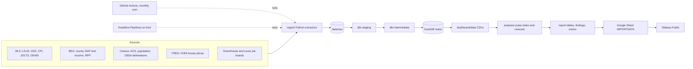

# US Metro Economic Pulse

**Which of the 50 largest US metros are gaining economic momentum, and where does an analyst's paycheck go furthest?** This repo answers both questions every month from official government data, with no manual steps.

<!-- TODO: add a screenshot of the Tableau dashboard at docs/img/dashboard.png -->


## Key findings (data through September 2026)

1. **Salt Lake City has the strongest momentum.** It leads the composite pulse index at +1.16, ahead of Raleigh (+0.91) and Charlotte (+0.84). Richmond, VA is last at −1.13. Across all metros, hiring is cooling: median job growth is 0.46% year over year, down from 0.55% three months earlier.
2. **Cost of living reshuffles the pay ranking.** After adjusting for BEA Regional Price Parities, Data Scientists earn the most in San Jose ($167,610), Seattle ($148,237) and San Francisco ($147,137). Austin climbs from #15 to #5 ($129,872). Sacramento falls from #32 to #50.
3. **A simple model edges out the baselines.** A Ridge nowcast of next-month unemployment scores 4.87% MAPE across 2,350 out-of-sample forecasts. That compares with 4.92% for seasonal naive and 7.20% for last value. Hartford (+0.94 pp) and Minneapolis (+0.81 pp) show the largest expected year-over-year rises.

Full write-ups: [findings](analysis/output/findings.md) and the [monthly memo](analysis/output/memo.md). Both are regenerated on every run.

## Architecture



All sources join on a CBSA crosswalk. The design decisions are in [docs/design.md](docs/design.md), and the model lineage is in [docs/models.md](docs/models.md).

## Tech stack

| Layer | Tools |
|---|---|
| Ingest | Python 3.12, requests, pandas, pytest |
| Warehouse | DuckDB, dbt-duckdb (staging → intermediate → marts, 86 dbt tests) |
| Analysis | pandas, scikit-learn (Ridge, expanding-window time-series CV) |
| Orchestration | GitHub Actions (monthly), Docker, Kubeflow Pipelines v2 on kind |
| Dashboard | Tableau Public, fed from Google Sheets |

Everything is free: no paid services, no credit card, and API keys are free.

## Data sources

| Source | Used for |
|---|---|
| [BLS LAUS](https://www.bls.gov/lau/) | Metro unemployment rate |
| [BLS CES State and Metro](https://www.bls.gov/sae/) | Nonfarm jobs and average hourly earnings |
| [BLS CPI](https://www.bls.gov/cpi/) | Metro or Census-division inflation, used for real wages |
| [BLS JOLTS](https://www.bls.gov/jlt/) | State job openings rate |
| [BLS OEWS](https://www.bls.gov/oes/) | Pay for 9 analyst occupations by metro |
| [BEA Regional](https://apps.bea.gov/regional/) | County GDP and income summed to metros; Regional Price Parities |
| [Census ACS 5-year](https://www.census.gov/programs-surveys/acs) | Income, education, poverty, rent burden |
| [Census population estimates and CBSA delineations](https://www.census.gov/programs-surveys/metro-micro.html) | Top-50 metro list and crosswalk |
| [FRED / FHFA HPI](https://fred.stlouisfed.org/) | House price index by metro |
| [Greenhouse](https://developers.greenhouse.io/job-board.html) and [Lever](https://github.com/lever/postings-api) public APIs | Analyst job postings from 40 company boards |

Known gaps are labeled in the data rather than hidden:
- BEA stopped publishing metro GDP in 2026.
- Metro CPI covers only 21 of the 50 metros.
- State JOLTS moved to annual releases.
- BLS published no October 2025 metro data because of the federal shutdown.

## How to run it

```bash
git clone https://github.com/khus-hi/us-metro-economic-pulse.git
cd us-metro-economic-pulse
python -m venv .venv && source .venv/bin/activate
pip install -r requirements.txt
cp .env.example .env              # add your free FRED, BLS, BEA and Census keys
make ingest                       # pull every source into data/raw
make warehouse                    # dbt seed, run and test in DuckDB
make export                       # marts -> dashboard/data/*.csv
python -m analysis run            # pulse index, nowcast, findings
python dashboard/report_tables.py # tables for the dashboard
```

- To try different pulse weights, edit `analysis/config.yml` or use `python -m analysis run --weights ...`.
- The Kubeflow version of the pipeline is documented in [docs/pipeline.md](docs/pipeline.md).
- The dashboard build is documented in [docs/dashboard.md](docs/dashboard.md).

## What I'd do next

- **Postings history:** collect job postings over several months, so demand trends replace a one-time snapshot.
- **Better nowcast:** add features such as weekly unemployment claims and the postings trend, and report prediction intervals instead of point forecasts.
- **Alerting:** send a short note when a metro's pulse moves more than one standard deviation in a month.
- **Price data:** test the index against a metro-level CPI alternative once BLS coverage changes.
