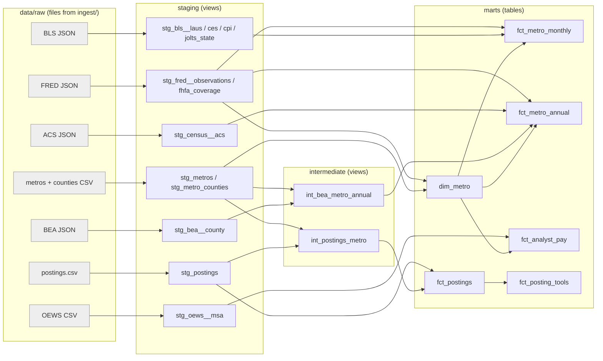

# Warehouse and dbt models

## Run it

```bash
pip install -r requirements.txt   # adds dbt-core, dbt-duckdb, duckdb
make warehouse                    # = cd models && dbt build --profiles-dir .
make freshness                    # source freshness from each _manifest.json
make docs                         # writes docs/dbt_docs.html (open it in a browser)
```

The warehouse is a single file, `warehouse/pulse.duckdb`. It's free, local, and needs no server. You can open it with the DuckDB CLI, Python (`duckdb.connect`), or DBeaver.

## Lineage, layer by layer



**1. Sources (`staging/_sources.yml`).** dbt-duckdb lets a source point at files: `read_text('data/raw/bls/*/laus_*.json')`. Nothing is copied. DuckDB reads the raw files when a model selects from them, so `data/raw` stays the single source of truth. A second set of sources reads each run's `_manifest.json`, which is what `dbt source freshness` checks.

**2. Staging (one model per source, views).** This layer handles renaming, typing and cleaning only, with no business logic:
- BLS responses are nested JSON (file → series → observations). They're flattened with `unnest(from_json(...))`, and the series ID is decoded into CBSA, measure and industry by character position. If a series was pulled more than once, the latest run wins.
- ACS: Census annotation codes such as `-555555555` become NULL, and the code is kept in `*_annotation`.
- BEA: `(D)` (suppressed) and `(NA)` become NULL with `is_suppressed = true`. Values are scaled by `UNIT_MULT`.
- OEWS: `*` (not available) becomes NULL, and `#` (wage above the top-code) sets `is_top_coded`.
- Postings: each posting gets a role family from its title, plus an `is_open` flag (seen in the latest run).

**3. Intermediate (reusable logic, views).**
- `int_bea_metro_annual`: BEA dropped metro tables in 2026, so this model sums counties into metros. It only sums additive measures, and records `counties_reported` vs `counties_expected` so an undercount is visible.
- `int_postings_metro`: splits each posting's location text and matches it to metros using city names from the CBSA title plus the state. It falls back to `remote_us`, `non_us`, `us_unmapped` or `unknown`, so nothing is dropped silently.

**4. Marts (tables the dashboard reads).**

| Model | Grain | What's in it |
|---|---|---|
| `dim_metro` | metro | names, region, population rank, `cpi_geo_level`, `fhfa_status`, county counts |
| `fct_metro_monthly` | metro × month | unemployment, labor force, nonfarm jobs (+YoY), earnings (+YoY), CPI (+YoY), real wage growth, state JOLTS rates, national benchmarks |
| `fct_metro_annual` | metro × year | GDP and personal income (county sums, `bea_is_complete`), per-capita income, ACS profile on its end year, FHFA HPI where whole-metro |
| `fct_analyst_pay` | metro × SOC | OEWS employment, wage percentiles, location quotient, pay vs. the metro's all-occupation median |
| `fct_postings` | posting × location | company, title, role family, remote, posted/first/last seen, tools |
| `fct_posting_tools` | posting × location × tool | answers "which tools do Boston analyst postings ask for?" |

## Tests (`*.yml`)

- **Uniqueness / grain:** `unique` on keys, and the custom `unique_combination` (in `tests/generic/`) on every mart's grain, e.g. `cbsa_code + month_date`.
- **Not-null and relationships:** every fact's `cbsa_code` must exist in `dim_metro`.
- **Accepted values:** for categories like `cpi_geo_level`, `fhfa_status`, `location_class` and `role_family`.
- **Accepted ranges:** the custom `accepted_range` test, e.g. unemployment between 0 and 30%, CPI YoY between −10 and 25%, median household income between $20k and $300k. These are sanity bounds to catch parsing bugs (a wrong unit or decimal), not forecasts.
- **Source freshness:** BLS and FRED warn after 35 days, postings after 2 days, and annual sources after 400 days.

## Interview talking points

- **Why views for staging and tables for marts?** Staging is cheap to recompute and always reflects the raw files. Marts are what the dashboard queries repeatedly, so they're materialized once.
- **Why an intermediate layer?** The county-to-metro sum and the location matching are reusable logic with their own edge cases. Isolating them keeps the marts readable and testable.
- **Honest metrics:** every proxy carries a flag (`cpi_geo_level`, `fhfa_status`, `bea_is_complete`, `is_top_coded`, `location_class`), so the dashboard can label it instead of quietly mixing metro and regional numbers.
- **Known limitation:** `rent_burdened_pct` uses all renter households as the denominator, including those where the ratio couldn't be computed, so it slightly understates the burden.
