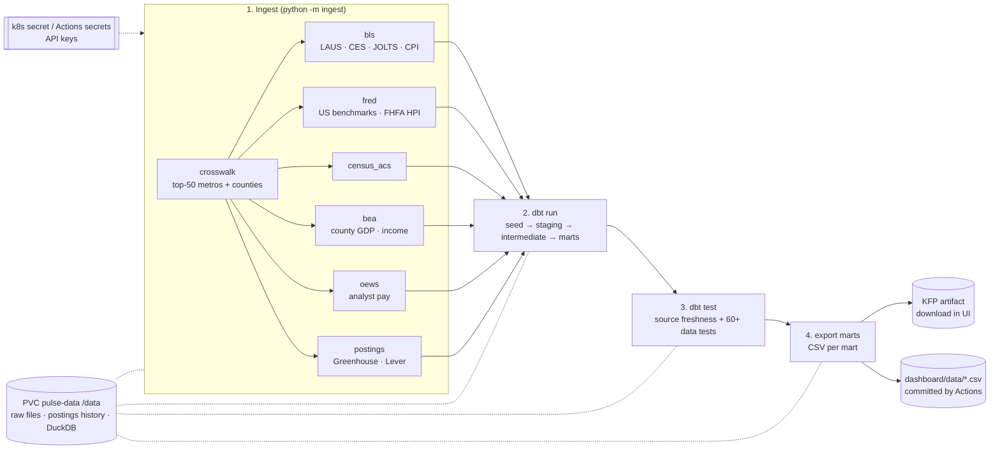

# Monthly pipeline: Kubeflow and GitHub Actions

The same four steps run in two places:

- **Kubeflow Pipelines (KFP v2)** on a free local `kind` cluster. This is the MLOps-style setup and the one to talk through in interviews.
- **GitHub Actions** on the public repo's free minutes. This is the always-on path. It runs even when your laptop is closed, and it commits the small mart CSVs to `dashboard/data/` for the dashboard.

Both read the same code (`ingest/`, `models/`, `dashboard/export_marts.py`) and run on the 20th of each month at 14:00 UTC.

## Pipeline diagram



| Step | KFP component | GitHub Actions step | Fails the run when |
|---|---|---|---|
| Ingest | `ingest(source)`: once for `crosswalk`, then 6 sources in parallel | `python -m ingest run all`, then the raw-data pytest checks | A source errors or a key is missing |
| dbt run | `dbt_run`: `dbt seed` + `dbt run` | same commands | A model fails to build |
| dbt test | `dbt_test`: `dbt source freshness` + `dbt test` | same commands | A source is past its error age, or a test fails (unique, not null, ranges, relationships) |
| Export | `export_marts`: output artifact `marts` | `python dashboard/export_marts.py`, then commit | A CSV would be over 25 MB |

Because dbt only runs after every source lands, and the export only runs after the tests pass, bad data never reaches the dashboard. A failed month leaves last month's CSVs in place.

## Option A: Kubeflow on your Mac (kind)

### What it costs your laptop

Use **KFP standalone** (just Pipelines, not the full Kubeflow platform with notebooks, Katib and so on) on a one-node `kind` cluster. That is the lightest real install.

These numbers are my estimate, not a figure from the Kubeflow docs:
- Give Docker 4 CPUs, 8 GB of memory and about 30 GB of disk.
- A Mac with 16 GB of RAM handles this.
- On an 8 GB Mac, use Option B instead.

KFP runs about 15 pods (API server, UI, Argo workflow controller, metadata store, database, object store).

Apple Silicon: `kind` and our image are both native arm64. I could not confirm that every KFP 2.18 system image ships an arm64 build. If a `kubeflow` pod fails with `exec format error` or `no match for platform`, use Option B for scheduling.

### One-time setup

```bash
# 1. Tools (free): Docker Desktop (free for personal use) or Colima, plus kind and kubectl
brew install kind kubectl
#    Docker Desktop > Settings > Resources: 4 CPUs, 8 GB memory

# 2. Cluster
kind create cluster --name pulse

# 3. Kubeflow Pipelines standalone, matching the SDK version (2.18.0)
export PIPELINE_VERSION=2.18.0
kubectl apply -k "github.com/kubeflow/pipelines/manifests/kustomize/cluster-scoped-resources?ref=$PIPELINE_VERSION"
kubectl wait --for condition=established --timeout=60s crd/applications.app.k8s.io
kubectl apply -k "github.com/kubeflow/pipelines/manifests/kustomize/env/dev?ref=$PIPELINE_VERSION"
kubectl wait --for=condition=ready pod --all -n kubeflow --timeout=900s   # a few minutes

# 4. Our image, loaded straight into kind (no registry, no Docker Hub account)
make image          # docker build -t pulse-pipeline:0.1 . && kind load docker-image ...

# 5. Shared disk and API keys
kubectl apply -n kubeflow -f orchestration/kfp/pvc.yaml
python orchestration/kfp/create_secret.py     # reads .env, creates secret pulse-api-keys

# 6. Compile, upload and schedule
pip install -r requirements-orchestration.txt
kubectl port-forward -n kubeflow svc/ml-pipeline-ui 8080:80   # keep this terminal open
make kfp-compile                                # -> orchestration/kfp/pulse_pipeline.yaml
python orchestration/kfp/schedule.py --now      # monthly recurring run + one run right now
```

Open http://localhost:8080 to watch the graph run. Click **export marts**, then the `marts` output, to download the CSVs.

### How the API keys get in (Kubernetes secret)

`create_secret.py` reads your `.env` with python-dotenv, the same parser the ingest code uses. It then runs `kubectl apply` on a secret named `pulse-api-keys` in the `kubeflow` namespace.

The pipeline mounts that secret as environment variables on the ingest steps only. Keys are never in the image, the compiled YAML or git.

- To check which keys exist, without showing their values: `kubectl describe secret pulse-api-keys -n kubeflow`.
- After you change a key in `.env`, re-run the script.

### Things to know

- **Schedule.** A KFP schedule only fires while the cluster is running. `no_catchup=True` means that if the laptop was off on the 20th, it runs once when the cluster is back, without backfilling every missed month.
- **Code changes.** After changing code, run `make image` again and bump the tag (`PULSE_IMAGE=pulse-pipeline:0.2`) so Kubernetes doesn't reuse the old cached image.
- **Shutting down.** `kind delete cluster --name pulse` removes everything, including the PVC data.

## Option B: GitHub Actions (no cluster)

The workflow is `.github/workflows/monthly.yml`. It costs nothing because GitHub Actions minutes are free for public repos.

### Add the secrets (once)

1. On GitHub, open the repo, then **Settings → Secrets and variables → Actions → New repository secret**.
2. Add each of these, with the same values as your `.env`:
   - `FRED_API_KEY`
   - `BLS_API_KEY`
   - `BEA_API_KEY`
   - `CONTACT_EMAIL`
   - `CENSUS_API_KEY`: optional. Leave it out while you have no key. The ingest code then uses the keyless Census download.
3. Alternatively, from your terminal: `gh secret set FRED_API_KEY`. It prompts for the value, so the key doesn't end up in your shell history.

Secrets are passed to the job as environment variables, and GitHub masks them in logs. Forks and pull requests from forks don't get them.

### Run it

- **First run:** go to the **Actions** tab, pick **monthly-pipeline**, then **Run workflow**, or run `gh workflow run monthly.yml`. Watch this first run. It is the first time the pulls come from GitHub's servers instead of your laptop.
- **After that:** it runs on the 20th of every month. It commits `dashboard/data/*.csv` only when the numbers changed.

### How postings history survives

Every Actions run starts on an empty machine, but postings dedupe needs last month's `postings.csv` to keep each job's `first_seen` date. So:
- The workflow uploads that file as a run artifact, kept 90 days.
- The next run downloads it from the last successful run.

Nothing large goes into git. Only the mart CSVs do.

### Limits worth knowing

- **Paused schedules.** GitHub pauses scheduled workflows in a public repo after 60 days with no repo activity. The monthly data commit normally counts as activity. If the schedule is ever paused, the Actions tab shows an **Enable workflow** button.
- **Push permission.** If the commit step fails with a permissions error, set **Settings → Actions → General → Workflow permissions** to "Read and write".

## Interview talking points

- **Same code everywhere.** One Docker image and one `requirements.txt` serve the laptop, Kubeflow and Actions, so a bug can't hide in one environment.
- **One component per step.** You get a separate log, retry and status for each source. When BEA is down, you see it is BEA and rerun only that step.
- **Caching off on purpose.** KFP caches a step when its inputs are unchanged. Here the real inputs are external APIs, so caching would silently skip new data.
- **State lives outside the pods.** Kubernetes pods are disposable. The PVC (KFP) or the run artifact (Actions) carries the postings history from month to month.
- **Tests gate the publish.** Freshness and data tests run before the export, so stale or broken data stops the run instead of reaching the dashboard.
- **Secrets are never in code.** They live in `.env` locally, in a Kubernetes Secret in the cluster, and in Actions secrets on GitHub.
